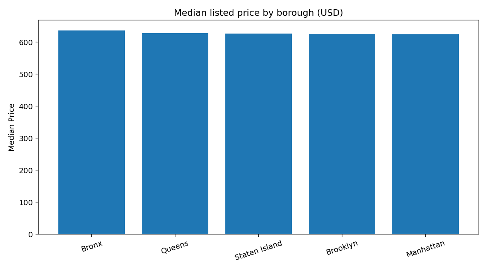
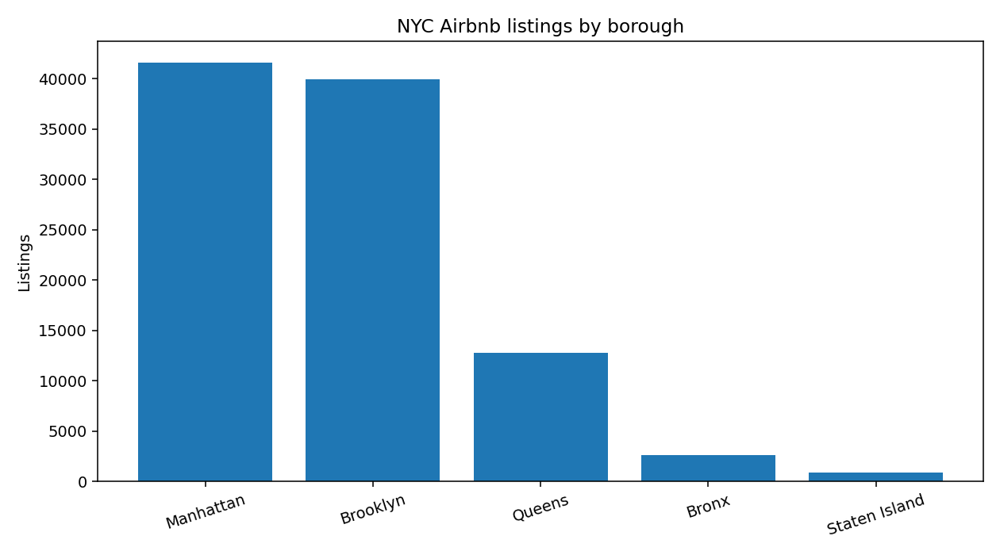
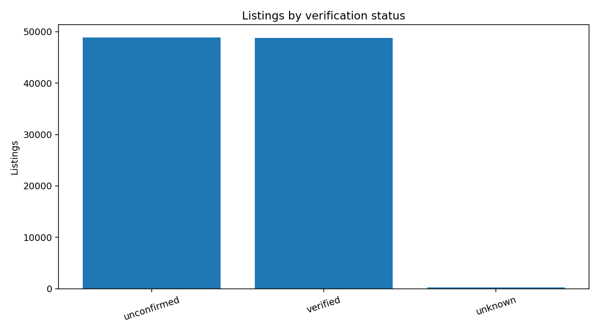
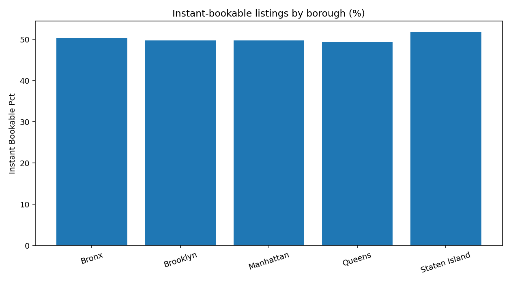
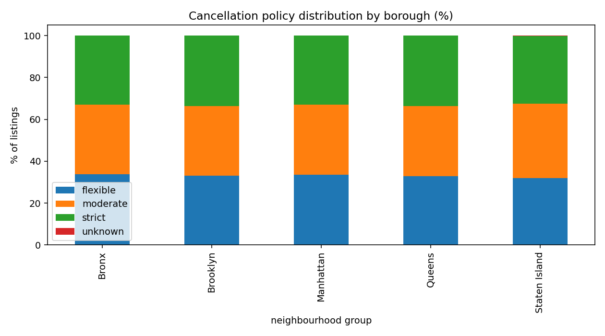

# New York City Airbnb Listing Market Analysis

**Python · Pandas · NumPy · Jupyter · Matplotlib · Seaborn**

An exploratory analysis of Airbnb listing attributes across the five New York City boroughs. The case study investigates market distribution, listed prices, service fees, host verification, instant booking, cancellation policies, and calendar availability.

**Scope:** These are descriptive statistics for the supplied `Airbnb_Open_Data.csv`, **not** estimates of NYC's entire Airbnb marketplace. Collection date, sampling methodology, accuracy of some fields, and provenance have not been independently verified. Prices are advertised listing values, not booking transaction prices.

## Key results

The supplied CSV contains **102,599 records**. After removing **541 exact duplicates** and excluding **4,126 further records** with missing or invalid core fields, the primary complete-case sample has **97,932 listings** (95.45% of original records). Two misspelled borough values are corrected (`manhatan`, `brookln`). **3,185** deduplicated records have invalid availability outside 0–365 days; **448** lack availability. Exclusion reasons may overlap. Missing reviews, host names, and house rules are not used as exclusion criteria.

### 1. Pricing and service fees

| Borough | Listings | Median price | Median service fee |
|---|---:|---:|---:|
| Bronx | 2,629 | $637 | $127 |
| Queens | 12,817 | $628 | $126 |
| Staten Island | 923 | $627 | $125 |
| Brooklyn | 39,937 | $626 | $125 |
| Manhattan | 41,626 | $624 | $125 |

Median price varies relatively little across boroughs in these records. This should **not** be interpreted as proof of normal NYC market pricing. Comparisons do not control for room type, property characteristics, or sampling biases. The dataset does not establish the billing basis of the `service fee` column; adding it to nightly price is an illustrative combined listed amount, **not a validated booking total**.

### 2. Listing concentration

Manhattan has **41,626 listings (42.51%)** and Brooklyn **39,937 (40.78%)**. Together they account for **83.29%** of the cleaned sample. Listing concentration is not a direct measure of demand.

### 3. Host verification labels

**48,793 listings (49.82%)** are labelled verified; **48,882 (49.91%)** unconfirmed; **257 (0.26%)** unknown. These are **shares of listings**, not distinct-host proportions. Rounded shares need not sum to exactly 100%.

### 4. Instant booking

Among listings with known status, instant booking rates are **51.84% Staten Island, 50.30% Bronx, 49.77% Brooklyn, 49.73% Manhattan, and 49.36% Queens**. There are **73** missing instant-booking statuses in the cleaned data; missing statuses are excluded from these rate denominators.

### 5. Cancellation policies

Flexible, moderate, and strict policies each represent roughly a third of listings in every borough. Missing policy labels are retained as `unknown`. This does not establish which policies generate more bookings.

### 6. Availability and host implications

Median days marked available are **79 Brooklyn, 93 Manhattan, 137 Queens, 168 Bronx, and 187 Staten Island**. Availability measures open calendar days, **not booked nights or realised occupancy**. Hosts can use the results to formulate hypotheses about listing position and market segmentation, but pricing recommendations require room type, amenity, property quality and reservation data. Marketplace operators may investigate differences in market composition and booking flexibility.

## Author

**Emmanuel Odili** · Data Analytics / Business Intelligence Portfolio

[LinkedIn Profile](https://www.linkedin.com/in/odiliemmanuel)
